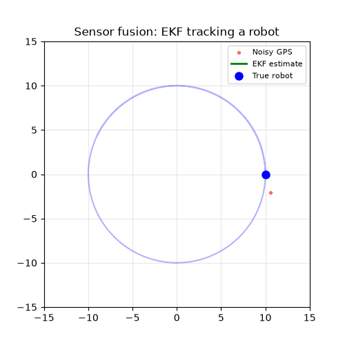
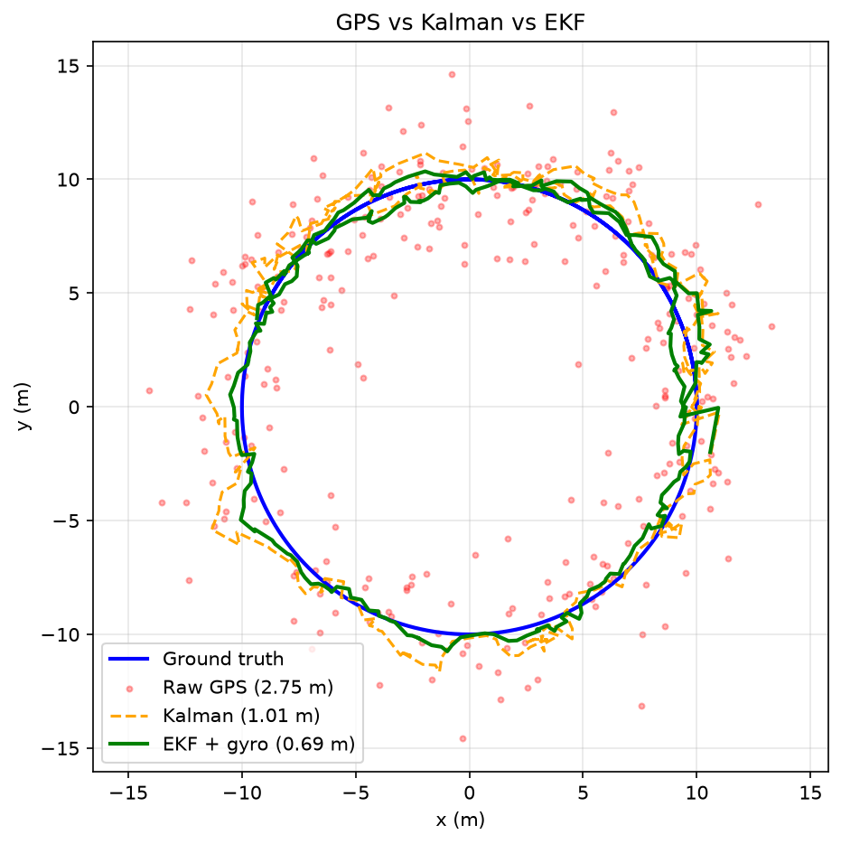
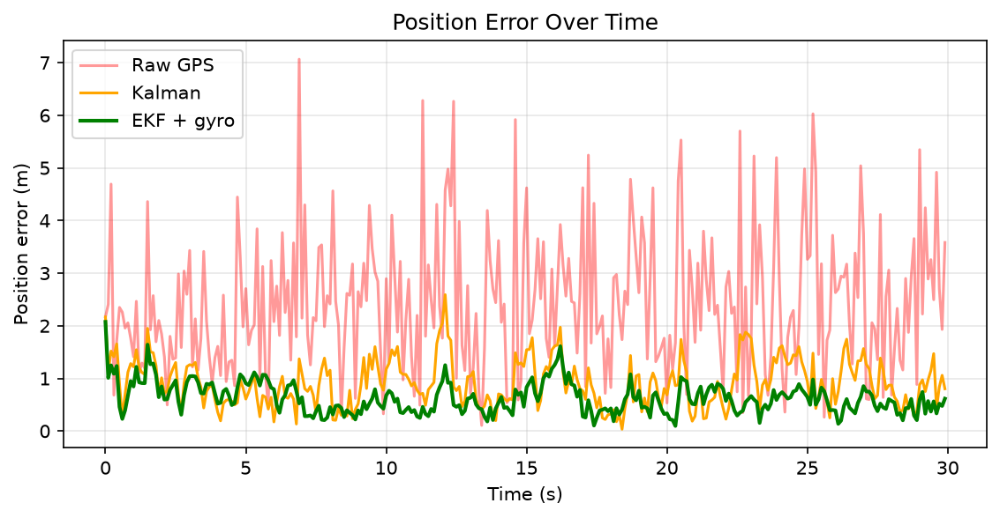

# Sensor Fusion Playground

Kalman Filter and Extended Kalman Filter (EKF) in Python that fuse noisy GPS and gyroscope data to track a robot driving in a circle.



## Results

| Method | RMSE (m) |
|---|---|
| Raw GPS | 2.75 |
| Kalman Filter | 1.01 |
| EKF + gyro | **0.69** |

The EKF cuts position error by **75%** compared with raw GPS.




## How it works

- **`simulate.py`**: simulates a robot moving in a 10 m radius circle with GPS noise (σ = 2 m).
- **`kalman.py`**: constant-velocity Kalman filter with state `[x, y, vx, vy]`.
- **`ekf.py`**: Extended Kalman Filter with a turning-motion model, state `[x, y, speed, heading, turn rate]`. It fuses GPS position with a simulated gyroscope.
- **`plots.py`**: sweeps the process-noise parameter to find the best tuning.
- **`make_results.py`**: produces the final plots and demo GIF.

## Key takeaways

- The plain Kalman filter assumes straight-line motion, so it struggles on a curved path.
- The EKF uses a nonlinear turning model and linearises it each step with a Jacobian.
- The EKF's extra gain comes from two things: the better motion model **and** the extra gyro sensor. Both contribute.
- Tuning the process noise matters: the EKF error ranged from 1.08 m to 0.69 m across the values I tested.

## Run it yourself

```bash
git clone https://github.com/Isaac-Otori/sensor-fusion-playground.git
cd sensor-fusion-playground
python -m venv venv
venv\Scripts\activate        # Mac/Linux: source venv/bin/activate
pip install -r requirements.txt
python make_results.py
```

## Limitations and next steps

- All data is simulated; next step is testing on real IMU/GPS logs.
- Noise values were tuned on one simulated run, so the results should be validated across multiple random seeds.
- Possible extensions: Unscented Kalman Filter, 3D motion, and a ROS2 node.